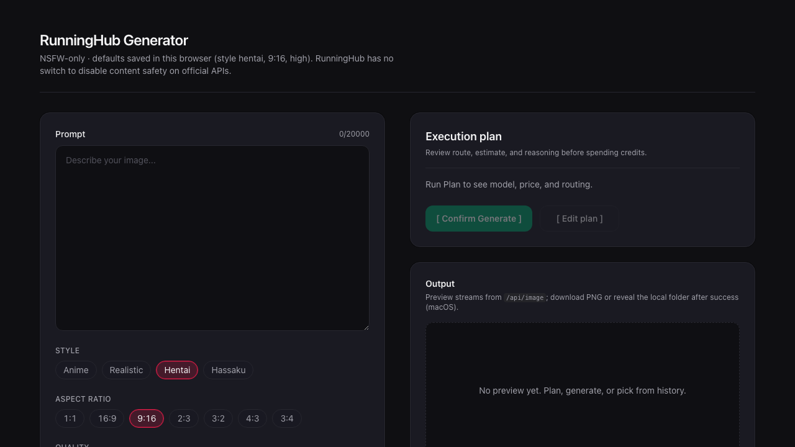
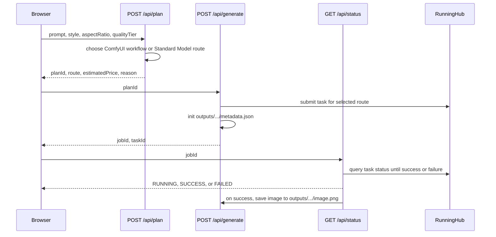

# RunningHub NSFW Image Generator (local)

Single-user Next.js app: enter a prompt, **plan** a generation path (model or ComfyUI workflow + estimated cost), **confirm**, poll until the image finishes, and save artifacts under `./outputs/`. Intended for **local Mac use only** (`npm run dev`).

**Documentation**

| Doc | Contents |
|-----|----------|
| [Implementation guide](docs/implementation-guide.md) | Detailed flows, mermaid diagrams, dual-backend behavior (less code, more description) |
| [Image creation pipeline](docs/image-creation-pipeline.md) | All resources and parameters used from plan → generate → status |
| [Design spec](docs/superpowers/specs/2026-05-21-runninghub-nsfw-generator-design.md) | Original product contract |
| [Build plan](docs/superpowers/plans/2026-05-21-runninghub-nsfw-generator.md) | Agent step-by-step implementation checklist |

## App workflow

### What you do in the UI

```text
┌─────────────┐     Plan      ┌──────────────┐    Confirm     ┌─────────────┐
│  Prompt +   │ ────────────► │  Plan card   │ ─────────────► │  Generating │
│ style/ratio │               │ model, ¥, why│                │  (polling)  │
│  / quality  │ ◄──────────── │  alternatives│                └──────┬──────┘
└─────────────┘   Edit plan   └──────────────┘                       │
       ▲                                                               ▼
       │                                                    ┌─────────────────┐
       └──────────────── History (past runs on disk) ◄──────│ image.png saved │
                                                            └─────────────────┘
```

1. **Enter** prompt and chips (style, aspect ratio, quality). Defaults: **Hentai · 9:16 · High**. Choices persist in browser `localStorage` (`runninghub-nsfw-prefs-v1`).
2. **Plan** — server picks a route, shows label, estimated price (Standard mode), reason, and up to two alternatives.
3. **Confirm** — server submits a RunningHub task and returns a `jobId`.
4. **Poll** — UI calls `/api/status` every ~8s until `SUCCESS` or `FAILED` (max ~6 minutes).
5. **View** — image served from `/api/image?jobId=...`; files also written under `outputs/YYYY-MM-DD/<jobId>/`.

No login, no payment UI — only your RunningHub account balance is charged when you confirm.

## Screenshots

| Home |
|------|
|  |

## App workflow

### What the server does (plan → generate → status)



### Generation modes

The app chooses the backend from `.env.local`:

| Mode | When | RunningHub API | Content safety | Price on plan card |
|------|------|----------------|----------------|--------------------|
| **ComfyUI workflow** | `RH_WORKFLOW_ID` is set | `POST /task/openapi/create` + poll `outputs` | Uses **your** checkpoint/workflow on RunningHub (no G-2 text filter) | Shown as ¥0 (billing on RunningHub) |
| **Standard Model** | `RH_WORKFLOW_ID` empty | `POST /openapi/v2/.../text-to-image` + `query` | G-2 **server-side** review (error `1501` on explicit prompts) | Live **price-preview** per model |

**ComfyUI setup:** import [`workflows/sdxl-txt2img-api.json`](workflows/sdxl-txt2img-api.json) on RunningHub, then set `RH_WORKFLOW_ID` — see [ComfyUI workflow setup](#comfyui-workflow-setup-recommended-for-nsfw) and [`workflows/README.md`](workflows/README.md).

### Router (Standard Model mode only)

When `RH_WORKFLOW_ID` is not set, `/api/plan` runs the curated router:

1. Load allowlist from [`data/models.json`](data/models.json) (`nsfwOk` + style match).
2. **Enhance** prompt with a style suffix (anime, realistic, hentai, hassaku).
3. **Price-preview** up to four candidates via RunningHub `POST /openapi/v2/price-preview/{route}`.
4. **Rank** by quality tier:
   - **Low** — cheapest estimated ¥
   - **High** — highest catalog `priority`, then price
   - **Medium** — balance `priority × 10 − price`
5. Save winning plan (+ up to two alternatives) to `.plans/<planId>.json`.

ComfyUI mode skips the router and builds a `nodeInfoList` (prompt, negative, width/height, steps, cfg, seed) mapped to nodes in `workflows/sdxl-txt2img-api.json` — overridable via `RH_WORKFLOW_*_NODE` env vars.

### API routes

| Route | Method | Role |
|-------|--------|------|
| `/api/plan` | POST | Create plan snapshot; return `planId`, route, price, reason |
| `/api/generate` | POST | Submit task from `planId`; create `outputs/...` job folder |
| `/api/status` | GET | Poll RunningHub; finalize `image.png` or failure |
| `/api/image` | GET | Serve saved `image.png` for a `jobId` |
| `/api/history` | GET | List runs from `outputs/**/metadata.json` |
| `/api/reveal` | GET | Reveal blurred preview metadata for a run |
| `/api/workflow-setup` | GET | Validate `RH_WORKFLOW_ID` and list editable workflow nodes |

### On-disk layout

```text
runninghub-app/
├── .env.local              # RH_API_KEY, PORT, optional RH_WORKFLOW_ID
├── data/models.json        # Standard Model catalog (router)
├── workflows/              # ComfyUI JSON to import on RunningHub
├── .plans/<planId>.json    # gitignored; plan TTL ~5 min
└── outputs/YYYY-MM-DD/<jobId>/
    ├── metadata.json       # status, prompts, route, usage
    ├── plan.json           # full plan snapshot
    └── image.png           # after SUCCESS
```

`outputs/` is gitignored. You may use a **symlink** to external storage (e.g. exFAT) — `listHistory` and job hydration skip macOS `._*` AppleDouble junk so `/api/status` and `/api/history` keep working after a dev-server restart.

## Prerequisites

- Node.js 18+ (align with your Next.js 15 toolchain)
- A RunningHub API key ([RunningHub console](https://www.runninghub.cn))

## Setup

```bash
cp .env.example .env.local
# Edit .env.local: set RH_API_KEY from RunningHub API console (server-side only).
# Optional: PORT=4000 (default dev port; change in .env.local).
# Optional: set RH_WORKFLOW_ID after importing the ComfyUI workflow (see below).

npm install
npm run dev
```

Open http://localhost:4000 (`npm run dev` reads `PORT` from `.env.local`, default **4000**).

Use **Plan** → review the card → **Confirm** to generate.

Production-style run (after build):

```bash
npm run build
npm run start
```

Without `RH_API_KEY`, plan/generate routes return **503** with a message about the missing key — add it to `.env.local` and restart the dev server.

## RunningHub notes

**API key tier (Standard Model):** G-2 text-to-image requires an **Enterprise-Shared** key. Consumer keys return error `1014` on Plan.

**Content safety (G-2):** No API or env switch disables review on Standard Model routes. Error `1501` means the prompt was blocked — use ComfyUI workflow mode or softer wording.

**ComfyUI workflow readiness:** Error **810** (`WORKFLOW_NOT_SAVED_OR_NOT_RUNNING`) means the ID is set but the workflow was not saved/run in the RunningHub UI yet. `/api/generate` and `/api/workflow-setup` return **502** with steps to fix. Error **801** means the workflow ID is invalid.

### ComfyUI workflow setup (recommended for NSFW)

1. Import [`workflows/sdxl-txt2img-api.json`](workflows/sdxl-txt2img-api.json) on [RunningHub](https://www.runninghub.cn) ([`workflows/README.md`](workflows/README.md)).
2. Set an uncensored SDXL checkpoint in **Load Checkpoint** and run the workflow once.
3. Copy the numeric ID from the workflow URL into `.env.local`:
   ```env
   RH_WORKFLOW_ID=1980237776367083521
   ```
4. Restart `npm run dev`.
5. Verify:
   ```bash
   curl -sS http://localhost:4000/api/workflow-setup
   ```

Plan should then show **ComfyUI workflow (RH_WORKFLOW_ID)** instead of a G-2 model.

## Scripts

| Command | Purpose |
|---------|---------|
| `npm run dev` | Next.js dev server (`PORT` from `.env.local`, default **4000**) |
| `npm run build` | Production build |
| `npm run start` | Serve production build (after `build`) |
| `npm run lint` | ESLint via Next.js |
| `npm test` | Router, Comfy plan, and output-store unit tests (Vitest) |

## Quick API smoke test

With the dev server running:

```bash
curl -sS -X POST http://localhost:4000/api/plan \
  -H 'Content-Type: application/json' \
  -d '{"prompt":"test","style":"hentai","aspectRatio":"9:16","qualityTier":"high"}'
```

Expect JSON with `planId`, `modelLabel`, `estimatedPrice` (Standard) or ComfyUI workflow fields — or an error if the key, tier, or network fails.
