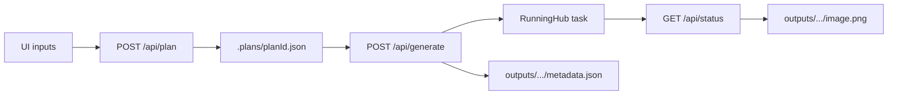

# Image creation pipeline — resources and parameters

Reference for every resource and parameter the app uses when creating an image, in pipeline order.

**Related:** [README](../README.md) · [Implementation guide](./implementation-guide.md) · [ComfyUI workflow setup](../workflows/README.md)

---

## Pipeline overview

**Mode selection** happens at plan time:

- `RH_WORKFLOW_ID` set in `.env.local` → **ComfyUI workflow** mode
- `RH_WORKFLOW_ID` empty → **Standard G-2** model router

---

## Stage 1 — User inputs

**Source:** `page.tsx` → `POST /api/plan`

| Parameter | Source | Allowed values | Default |
|-----------|--------|----------------|---------|
| `prompt` | UI text field | Non-empty string, max 20,000 chars | `""` (browser may restore from `localStorage`) |
| `style` | UI chip | `anime`, `realistic`, `hentai`, `hassaku` | `hentai` |
| `aspectRatio` | UI chip | `1:1`, `16:9`, `9:16`, `2:3`, `3:2`, `4:3`, `3:4` | `9:16` |
| `qualityTier` | UI chip | `low`, `medium`, `high` | `high` |

**Browser persistence** (not sent to RunningHub): `localStorage` key `runninghub-nsfw-prefs-v1` restores the form on return visits.

Defaults are defined in `src/lib/nsfw-defaults.ts`.

---

## Stage 2 — Plan

**Modules:** `src/lib/router.ts`, `src/lib/comfy-plan.ts`, `src/lib/workflow-config.ts`

### Shared (both modes)

| Resource / parameter | Where it comes from |
|---------------------|---------------------|
| Enhanced prompt | User `prompt` + style suffix (`STYLE_SUFFIX` in `router.ts`) |
| `planId` | Random UUID |
| Plan TTL | 5 minutes (`.plans/<planId>.json`) |

**Style suffixes** appended to the user prompt:

| Style | Suffix |
|-------|--------|
| `anime` | `, anime style, vibrant colors, detailed illustration` |
| `realistic` | `, photorealistic, natural lighting, high detail` |
| `hentai` | `, anime art style, mature themes` |
| `hassaku` | `, soft anime shading, clean lineart` |

---

### Mode A — Standard Model (`RH_WORKFLOW_ID` unset)

#### Config files

| File | Role |
|------|------|
| `data/models.json` | Allowlisted models, routes, tier maps, priorities |

#### Models in catalog

| `modelId` | RunningHub route | Styles | Priority |
|-----------|------------------|--------|----------|
| `g2-official` | `rhart-image-g-2-official/text-to-image` | anime, realistic, hentai, hassaku | 10 |
| `g2-budget` | `rhart-image-g-2/text-to-image` | anime, hentai, realistic, hassaku | 5 |

#### Router logic

1. Filter models where `nsfwOk === true` and style matches.
2. Price-preview up to **four** candidates via RunningHub.
3. Rank by `qualityTier`:
   - **low** — cheapest estimated ¥
   - **high** — highest `priority`, then price
   - **medium** — score `priority × 10 − price`

#### Parameters sent to RunningHub (price-preview and submit)

| Field | Source |
|-------|--------|
| `prompt` | Enhanced prompt |
| `aspectRatio` | User selection (passed through) |
| `resolution` | From model `tierMap[qualityTier]` |
| `quality` | From model `tierMap[qualityTier]` |

#### `tierMap` per model

| Tier | g2-official | g2-budget |
|------|-------------|-----------|
| low | `1k` / `low` | `1k` / `low` |
| medium | `2k` / `medium` | `2k` / `medium` |
| high | `4k` / `high` | `2k` / `medium` |

#### RunningHub API (plan phase)

| Call | Endpoint | Auth |
|------|----------|------|
| Price preview | `POST https://www.runninghub.cn/openapi/v2/price-preview/{route}` | `Authorization: Bearer RH_API_KEY` |

#### Plan snapshot fields used later

`route`, `params` (SubmitBody), `modelId`, `modelLabel`, `estimatedPrice`, `mode: "standard"`.

---

### Mode B — ComfyUI workflow (`RH_WORKFLOW_ID` set)

#### Environment

| Variable | Default | Role |
|----------|---------|------|
| `RH_WORKFLOW_ID` | — | RunningHub workflow ID (from UI import) |
| `RH_WORKFLOW_PROMPT_NODE` | `6` | CLIP positive node |
| `RH_WORKFLOW_NEGATIVE_NODE` | `7` | CLIP negative node |
| `RH_WORKFLOW_SIZE_NODE` | `5` | EmptyLatentImage node |
| `RH_WORKFLOW_SAMPLER_NODE` | `3` | KSampler node |

#### Shipped workflow graph

File: `workflows/sdxl-txt2img-api.json` (import on RunningHub once; API references the resulting `workflowId`).

| Node | Class | App overrides? | Fixed in JSON (not overridden by app) |
|------|-------|----------------|--------------------------------------|
| 3 | KSampler | `steps`, `cfg`, `seed` | `scheduler: karras`, `sampler_name: dpmpp_2m`, `denoise: 1` |
| 4 | CheckpointLoaderSimple | — | `ckpt_name` (chosen on RunningHub, e.g. `juggernautXL_v9.safetensors`) |
| 5 | EmptyLatentImage | `width`, `height` | `batch_size: 1` |
| 6 | CLIPTextEncode | `text` (positive) | Wired to checkpoint CLIP |
| 7 | CLIPTextEncode | `text` (negative) | Wired to checkpoint CLIP |
| 37 | VAEDecode | — | Uses checkpoint VAE |
| 9 | SaveImage | — | `filename_prefix: runninghub-nsfw` |

#### App-computed Comfy parameters

Built in `buildComfyNodeInfoList` (`src/lib/comfy-plan.ts`):

| Field | Mapping |
|-------|---------|
| Positive `text` | Enhanced prompt |
| Negative `text` | Fixed: `low quality, blurry, watermark, text, bad anatomy, deformed` |
| `width` × `height` | From aspect ratio (SDXL sizes below) |
| `steps` | low 18 / medium 25 / high 32 |
| `cfg` | low 7 / medium 7.5 / high 8 |
| `seed` | Random `0 … 2³²−1` per plan |

#### Dimensions by aspect ratio

| Ratio | Width × height |
|-------|----------------|
| 1:1 | 1024 × 1024 |
| 16:9 | 1344 × 768 |
| 9:16 | 768 × 1344 |
| 2:3 | 832 × 1216 |
| 3:2 | 1216 × 832 |
| 4:3 | 1152 × 896 |
| 3:4 | 896 × 1152 |
| (unknown) | Falls back to 1:1 |

#### Plan snapshot fields used later

`workflowId`, `nodeInfoList`, `mode: "comfy"`, `route: "comfyui/workflow"`.

No price-preview in Comfy mode (`estimatedPrice: 0` placeholder on the plan card).

---

## Stage 3 — Generate

**Route:** `POST /api/generate`  
**Input:** `planId` (must be younger than 5 minutes)

### Secrets

| Resource | Usage |
|----------|--------|
| `RH_API_KEY` | All RunningHub API calls |

### Standard submit

| Call | Endpoint | Body |
|------|----------|------|
| Submit | `POST /openapi/v2/{route}` | `{ prompt, aspectRatio, resolution, quality }` |

**Returns:** `taskId`

### Comfy submit

| Call | Endpoint | Body |
|------|----------|------|
| Create task | `POST /task/openapi/create` | `{ apiKey, workflowId, nodeInfoList }` |

**Returns:** `taskId`

### Local artifacts created

| Path | Contents |
|------|----------|
| `outputs/YYYY-MM-DD/<jobId>/plan.json` | Full plan snapshot |
| `outputs/YYYY-MM-DD/<jobId>/metadata.json` | `jobId`, `taskId`, prompts, style, route, `status: RUNNING`, etc. |
| In-memory `jobs` Map (`src/lib/jobs.ts`) | Fast polling until dev-server restart (then rehydrated from disk) |

---

## Stage 4 — Status polling

**Route:** `GET /api/status?jobId=`

| Parameter | Value |
|-----------|--------|
| Poll interval (UI) | 8 seconds |
| Server max polls | 60 (~6 minutes) |

### Standard poll

| Call | Endpoint | Body |
|------|----------|------|
| Query | `POST /openapi/v2/query` | `{ taskId }` |

**Watches:** `results[0].url`, `status`, `errorCode`, `errorMessage`, `usage`

### Comfy poll

| Call | Endpoint | Body |
|------|----------|------|
| Outputs | `POST /task/openapi/outputs` | `{ apiKey, taskId }` |

**Status codes:** `0` success + `fileUrl`, `804` running, `813` queued, `805` failed

---

## Stage 5 — Finalize (on SUCCESS)

| Resource | Role |
|----------|------|
| RunningHub image URL | `results[0].url` (standard) or `data[0].fileUrl` (Comfy) |
| `downloadImage()` | HTTP GET of that URL (`src/lib/runninghub.ts`) |
| `outputs/.../image.png` | Saved file on disk |
| `metadata.json` | Updated: `status: SUCCESS`, `imageFile`, optional `actualUsage` |

Image is served to the UI via `GET /api/image?jobId=`.

---

## Control matrix

| You control (UI / `.env.local`) | App-fixed | Platform-fixed (workflow on RunningHub) |
|----------------------------------|-----------|----------------------------------------|
| prompt, style, aspect, quality | Style suffixes, Comfy negative prompt, steps/cfg/seed, dimensions | Checkpoint, sampler name, scheduler, VAE graph |
| `RH_API_KEY` | Model catalog, ranking | G-2 content rules (standard mode) |
| `RH_WORKFLOW_ID` + node overrides | Plan TTL, poll caps | Checkpoint choice in Comfy UI |

---

## Module map

| Stage | Primary modules |
|-------|-----------------|
| UI inputs | `src/app/page.tsx`, `src/lib/nsfw-defaults.ts` |
| Plan | `src/lib/router.ts`, `src/lib/comfy-plan.ts`, `src/lib/workflow-config.ts`, `src/lib/plans.ts` |
| Generate | `src/app/api/generate/route.ts`, `src/lib/runninghub.ts`, `src/lib/runninghub-comfy.ts` |
| Status | `src/app/api/status/route.ts`, `src/lib/jobs.ts`, `src/lib/output-store.ts` |
| Errors | `src/lib/runninghub-errors.ts` |

---

*Last updated: 2026-07-09 — port 4000, ComfyUI mode, exFAT-safe output scanning.*
