# RunningHub NSFW Generator — Implementation Guide

**Date:** 2026-05-21  
**Project:** `runninghub-app`  
**Audience:** Developers and operators who need to understand how the app is built and how data moves through it — without reading every source file.

**Related docs**

| Document | Purpose |
|----------|---------|
| [Design spec](./superpowers/specs/2026-05-21-runninghub-nsfw-generator-design.md) | Original product contract (partially superseded by ComfyUI mode) |
| [Build plan](./superpowers/plans/2026-05-21-runninghub-nsfw-generator.md) | Step-by-step agent implementation checklist |
| [README](../README.md) | Setup, quick start, operator notes |
| [ComfyUI workflow setup](../workflows/README.md) | Import `sdxl-txt2img-api.json` on RunningHub |

---

## 1. What this application does

The app is a **local, single-user image generator** that sits between you and [RunningHub](https://www.runninghub.cn). You describe what you want; the server decides *how* to call RunningHub (Standard Model API or ComfyUI workflow); you **confirm before money is spent**; the server polls until an image exists and saves everything under `./outputs/` for history and learning.

Design principles:

- **Transparency** — Every run records which route was chosen, why, and what it cost (when RunningHub exposes it).
- **Confirm-before-spend** — Planning is separate from submission so you can reject a route or price.
- **No auth layer** — Trust is “whoever can reach localhost:4000 and has `RH_API_KEY` in `.env.local`.”
- **Disk as database** — Plans and jobs are JSON files; no Postgres or Supabase.

---

## 2. System context

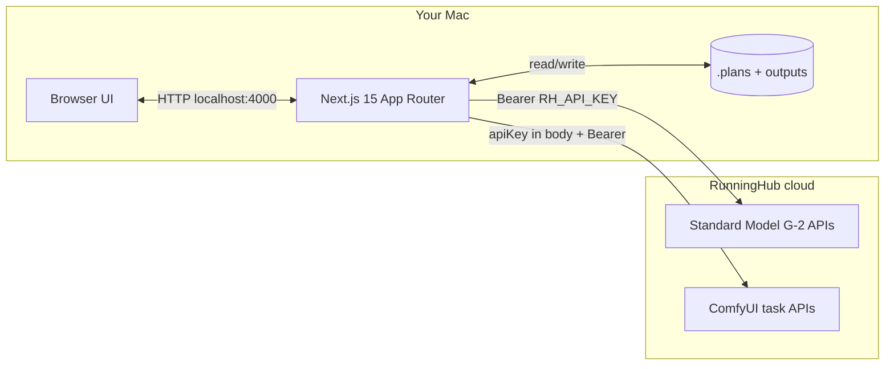

| Layer | Technology | Role |
|-------|------------|------|
| UI | React client component (`page.tsx`) | Form, plan card, polling loop, history sidebar |
| API | Next.js Route Handlers under `src/app/api/` | Validate input, orchestrate lib modules, return JSON |
| Domain logic | `src/lib/*` | Router, RunningHub clients, persistence, in-memory jobs |
| Config | `.env.local`, `data/models.json`, optional `RH_WORKFLOW_*` | Secrets and allowlists |
| Artifacts | `outputs/`, `.plans/` | Gitignored run history and short-lived plans |

Dev server listens on **`PORT` from `.env.local`** (default **4000**). `npm run dev` sources `.env.local` before starting Next.js.

---

## 3. End-to-end user workflow

### 3.1 Happy path (operator view)

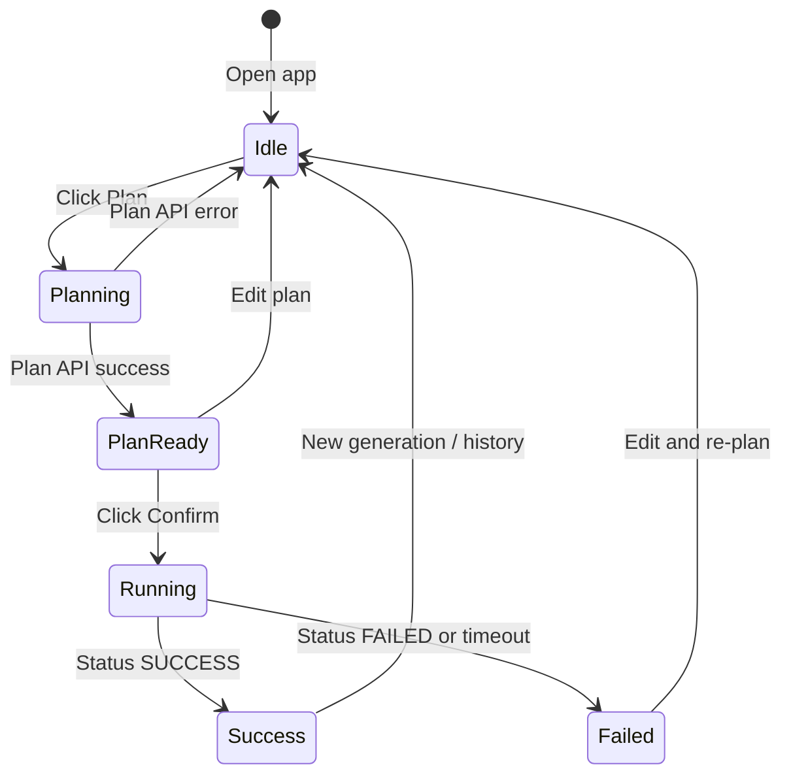

| Step | User action | System effect |
|------|-------------|---------------|
| 1 | Enter prompt, style, aspect ratio, quality | Values merged with NSFW defaults; optional restore from `localStorage` |
| 2 | **Plan** | Server builds a plan snapshot; UI shows model/workflow, price (if known), reason, alternatives |
| 3 | Review plan card | No RunningHub spend yet |
| 4 | **Confirm** | Server submits async task; creates job folder; UI enters polling state |
| 5 | Wait (~30s–6min) | Browser polls `/api/status` every 8 seconds |
| 6 | Success | Image shown via `/api/image`; files on disk under `outputs/YYYY-MM-DD/<jobId>/` |
| 7 | History | Past runs loaded from disk scan; can reopen metadata and image |

### 3.2 Browser ↔ server sequence

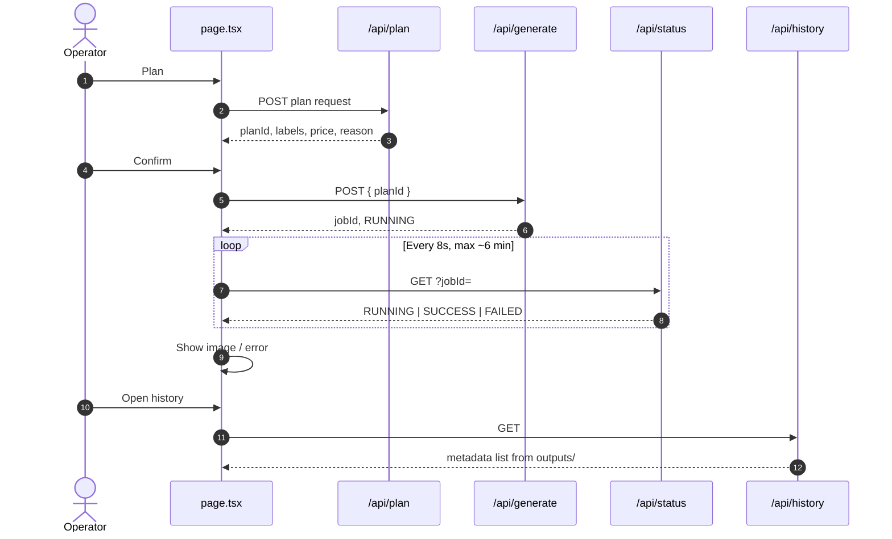

The UI does **not** talk to RunningHub directly. All platform calls go through server routes so `RH_API_KEY` never reaches the browser.

---

## 4. Dual backend: how the app picks a path

At startup the server reads `RH_WORKFLOW_ID`. If it is non-empty, **every** plan uses ComfyUI workflow mode. Otherwise **every** plan uses the Standard Model router.

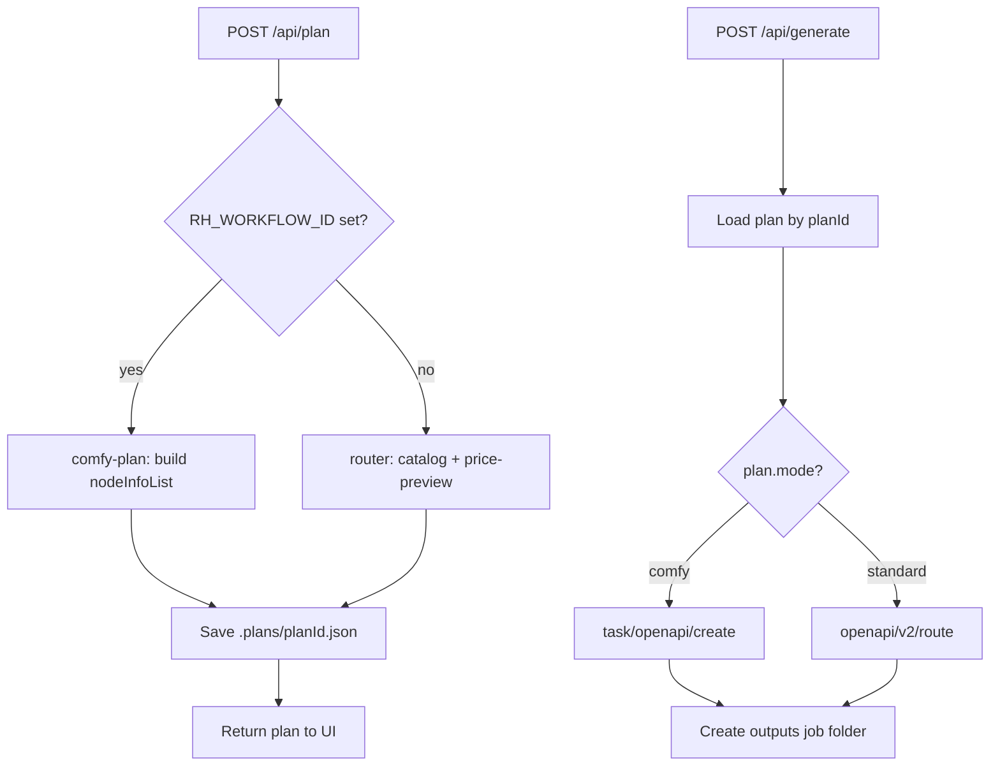

### 4.1 Standard Model mode

**When:** `RH_WORKFLOW_ID` is unset.

**RunningHub surface:** OpenAPI v2 — price preview, text-to-image submit, task query. Auth header: `Authorization: Bearer <RH_API_KEY>`.

**Strengths:** Live **estimated price** on the plan card; no ComfyUI setup.

**Weaknesses for NSFW:** G-2 official routes run **server-side content safety** (error `1501`). Consumer API keys may get `1014` (Enterprise-Shared required). Explicit prompts often fail regardless of app settings.

**Catalog:** `data/models.json` lists a small allowlist (e.g. G-2 official, G-2 budget). Each entry defines which styles it supports, resolution/quality per tier, and a priority score for ranking.

### 4.2 ComfyUI workflow mode

**When:** `RH_WORKFLOW_ID` is set in `.env.local`.

**RunningHub surface:** Task OpenAPI — create task with `workflowId` + `nodeInfoList`, poll **outputs** endpoint (not v2 query). Same API key; body also includes `apiKey`.

**Strengths:** Generation runs **your** graph and checkpoint on RunningHub — typically **no G-2 text filter** on this path.

**Weaknesses:** No built-in price preview in app (plan shows ¥0 placeholder); you must **import** the shipped workflow on RunningHub once to obtain a numeric workflow ID (platform does not mint IDs via API).

**Shipped graph:** `workflows/sdxl-txt2img-api.json` — SDXL checkpoint → positive/negative CLIP → KSampler → VAE decode → SaveImage.

Detailed import steps: [workflows/README.md](../workflows/README.md).

---

## 5. Planning workflow (server)

### 5.1 Standard Model router

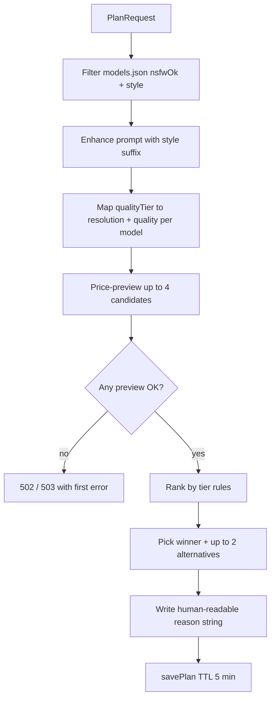

**Style suffixes** (appended server-side, stored in plan as enhanced prompt):

| Style | Intent of suffix |
|-------|------------------|
| Anime | Vibrant illustration look |
| Realistic | Photorealistic lighting and detail |
| Hentai | Anime + mature themes (still blocked on G-2 if explicit) |
| Hassaku | Soft anime shading, clean lineart |

**Ranking by quality tier:**

| Tier | Selection bias |
|------|----------------|
| Low | Lowest estimated ¥ among previews that succeeded |
| High | Highest catalog `priority`, then lower price among ties |
| Medium | Score = `priority × 10 − estimatedPrice` |

The router never searches RunningHub’s full catalog — only entries you curate in `models.json`.

### 5.2 ComfyUI plan builder

When workflow mode is active, planning **skips** the catalog and price-preview loop.

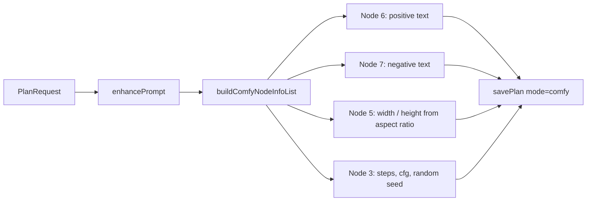

**Aspect ratio → pixels** (SDXL-friendly sizes):

| Ratio | Width × height |
|-------|----------------|
| 1:1 | 1024 × 1024 |
| 9:16 | 768 × 1344 |
| 16:9 | 1344 × 768 |
| 2:3 / 3:2 / 4:3 / 3:4 | Mapped in `comfy-plan` (see lib) |

**Quality tier → sampler:**

| Tier | Steps (approx.) | CFG (approx.) |
|------|-----------------|---------------|
| Low | 18 | 7.0 |
| Medium | 25 | 7.5 |
| High | 32 | 8.0 |

Node IDs default to the shipped workflow (6, 7, 5, 3) but can be overridden with `RH_WORKFLOW_PROMPT_NODE`, etc.

---

## 6. Generation and polling workflow (server)

### 6.1 Submit (Confirm)

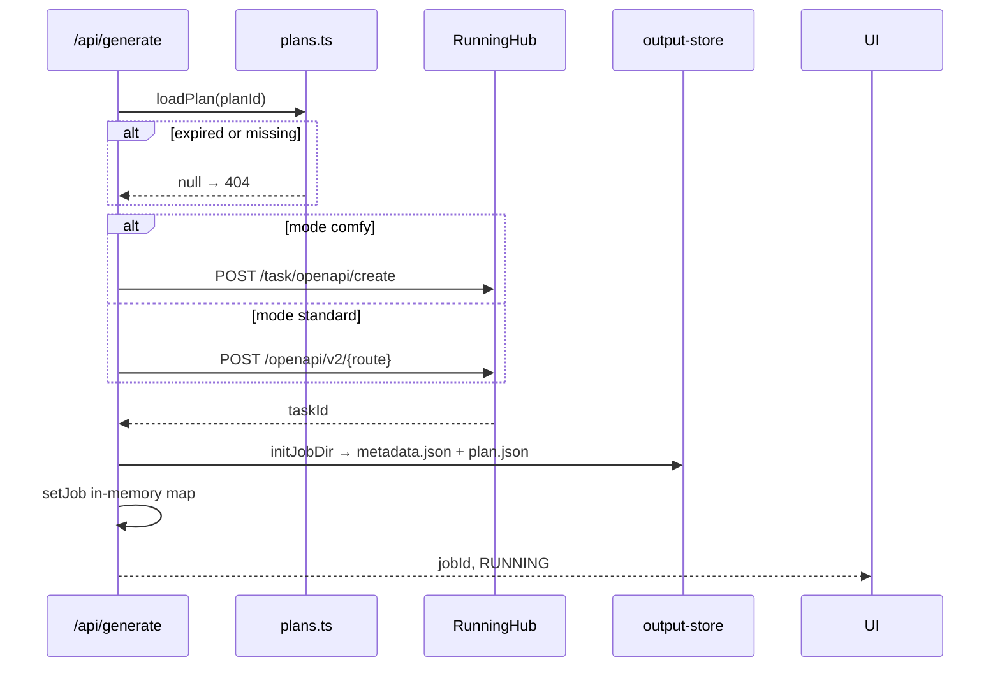

Each job gets a new UUID. The RunningHub `taskId` is stored in metadata for polling. In-memory `jobs` map holds poll count and status for the current dev-server process; disk metadata allows **hydration** after restart via `ensureJobHydrated`.

### 6.2 Poll and finalize

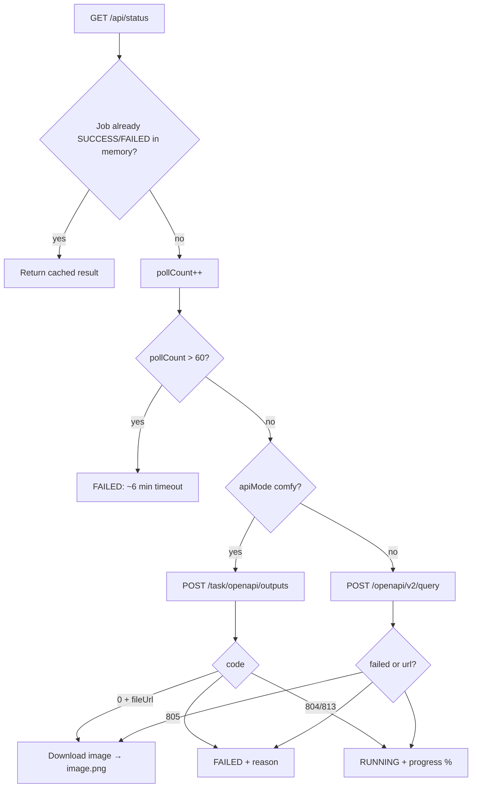

**ComfyUI output codes** (from RunningHub docs / integration example):

| Code | Meaning |
|------|---------|
| 0 | Done — `data[0].fileUrl` present |
| 804 | Still running |
| 813 | Queued |
| 805 | Failed — may include `failedReason` with node name and exception |

**Standard query** uses `results[0].url` and status/error fields on the v2 query response.

On success, `finalizeSuccess` downloads the remote URL and writes `image.png`. On failure or timeout, `finalizeFailed` updates `metadata.json` without an image.

---

## 7. ComfyUI workflow lifecycle (operator + platform)

This is separate from the **app’s** plan/generate flow: it is how the graph gets a `workflowId` on RunningHub.

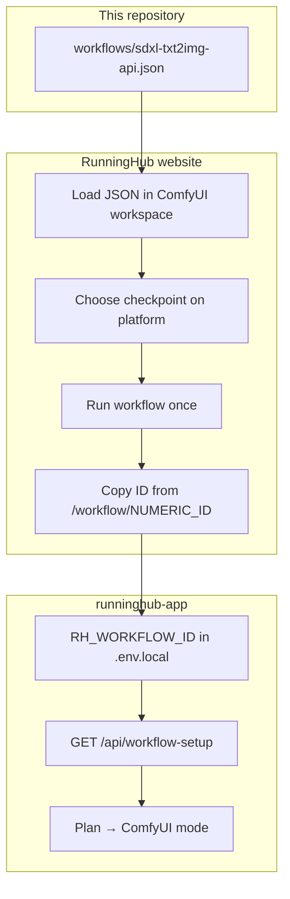

**Why run once in the UI?** RunningHub registers the workflow and binds platform assets (checkpoints) to your account. The API only references an existing `workflowId`.

**Verification endpoint** (`/api/workflow-setup`) calls RunningHub “get workflow JSON” and lists editable scalar fields — useful after you change node IDs in ComfyUI.

### Default node graph (conceptual)

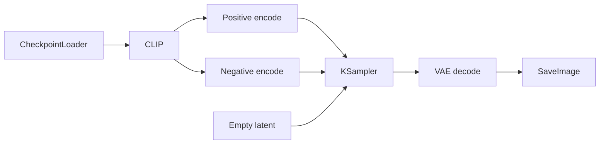

The app only overrides **text**, **latent size**, and **sampler** fields via `nodeInfoList`; the checkpoint name remains whatever you saved on RunningHub.

---

## 8. Persistence model

### 8.1 Plan snapshots (pre-spend)

| Property | Value |
|----------|--------|
| Location | `.plans/<planId>.json` |
| TTL | 5 minutes from `createdAt` |
| Purpose | Bind Confirm to a frozen route, params, and price estimate |

If Confirm happens after TTL, generate returns **404 plan expired**.

### 8.2 Job folders (post-spend)

```text
outputs/YYYY-MM-DD/<jobId>/
├── metadata.json   # status, prompts, apiMode, taskId, usage, errors
├── plan.json       # full plan snapshot at time of generate
└── image.png       # written only on SUCCESS
```

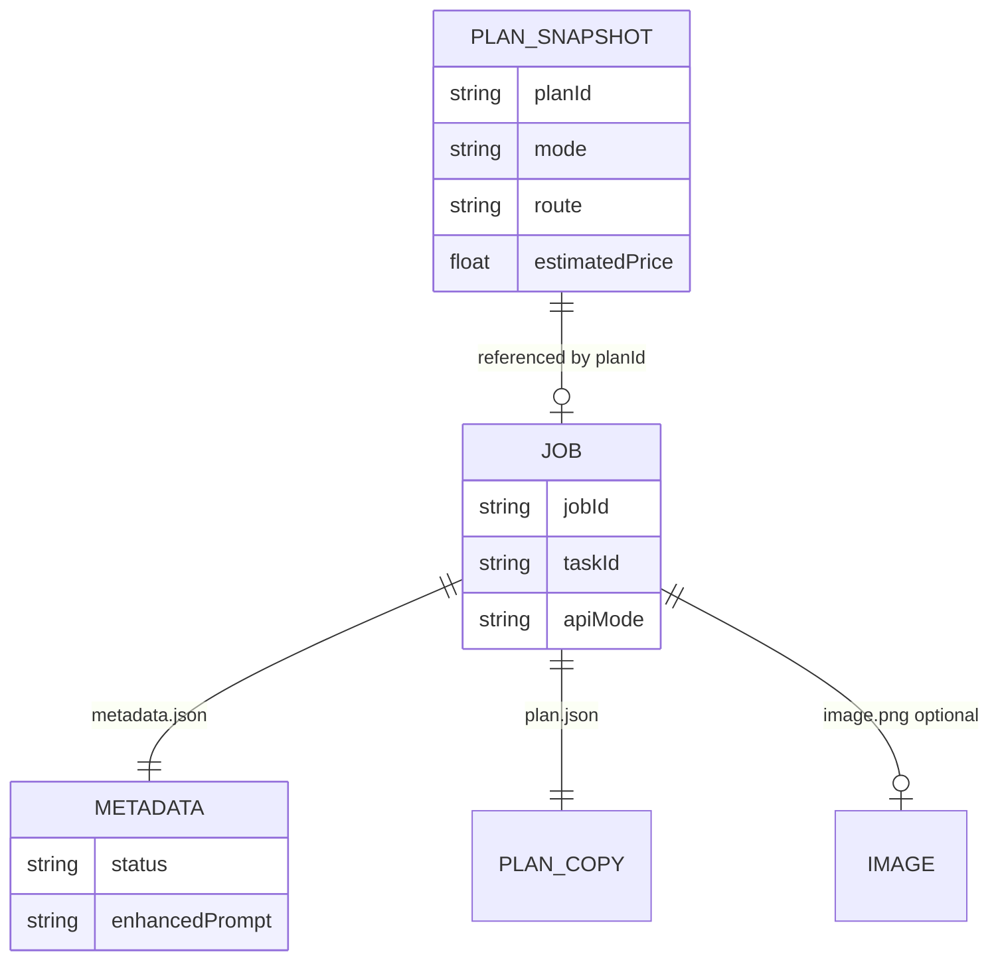

**History API** walks `outputs/**/metadata.json`, sorts by `createdAt`, returns the latest N entries. No separate index file. Directory scans skip hidden names (including macOS `._*` AppleDouble files on exFAT volumes) so symlinked external `outputs/` folders remain readable.

**Job lookup** uses `findRunDirByJobId` for direct `outputs/YYYY-MM-DD/<jobId>/` resolution before falling back to a full history scan — this powers `/api/status`, `/api/image`, and `/api/reveal` after a dev-server restart.

### 8.3 In-memory job cache

`src/lib/jobs.ts` keeps a `Map` of active jobs for fast polling within one Node process. After `next dev` restart, the first status poll **rehydrates** from disk via `ensureJobHydrated` → `findRunByJobId` (which reads `metadata.json` under `outputs/`).

---

## 9. Module responsibilities

Descriptions only — open the file when you need to change behavior.

| Module | Responsibility |
|--------|----------------|
| `runninghub.ts` | Standard Model HTTP: price preview, submit, query, image download |
| `runninghub-comfy.ts` | ComfyUI HTTP: create task, poll outputs, fetch workflow JSON for setup |
| `runninghub-errors.ts` | Map RunningHub codes (1014, 1501, 1505) and ComfyUI codes (801, 810) to operator-readable messages |
| `workflow-config.ts` | Read `RH_WORKFLOW_ID` and optional node ID overrides |
| `router.ts` | Catalog load, filter, enhance, preview, rank, `createPlan` entry (delegates to comfy when configured) |
| `comfy-plan.ts` | Dimension map, node list builder, `createComfyPlan` |
| `plans.ts` | TTL read/write for `.plans/` |
| `output-store.ts` | Job directory creation, finalize success/failure, history scan, direct job-dir lookup |
| `jobs.ts` | In-memory job state + hydration |
| `nsfw-defaults.ts` | Default style/ratio/tier; browser `localStorage` helpers |
| `types.ts` | Shared TypeScript shapes (`PlanSnapshot`, `RunMetadata`, `ApiMode`) |

| Route | Responsibility |
|-------|----------------|
| `api/plan` | Validate body, call `createPlan`, return JSON or mapped HTTP status |
| `api/generate` | Load plan, submit Standard or Comfy task, init output dir |
| `api/status` | Poll RunningHub, finalize files, enforce 60-poll cap |
| `api/image` | Stream `image.png` for a jobId with path guard |
| `api/history` | List recent runs from disk |
| `api/reveal` | macOS `open` on output folder (local only) |
| `api/workflow-setup` | Validate workflow ID against RunningHub |

| UI (`page.tsx`) | Responsibility |
|-----------------|----------------|
| Form state | Prompt + chips + persistence |
| Plan card | Display plan fields and alternatives |
| Polling | `setInterval` 8s calling status until terminal state |
| History sidebar | Load and select past runs |

---

## 10. Configuration surface

| Variable | Required | Effect |
|----------|----------|--------|
| `PORT` | No | Dev server port (default `4000`; read from `.env.local` by `npm run dev`) |
| `RH_API_KEY` | Yes | RunningHub authentication (server only) |
| `RH_WORKFLOW_ID` | No | Enables ComfyUI mode when set |
| `RH_WORKFLOW_PROMPT_NODE` | No | Default `6` |
| `RH_WORKFLOW_NEGATIVE_NODE` | No | Default `7` |
| `RH_WORKFLOW_SIZE_NODE` | No | Default `5` |
| `RH_WORKFLOW_SAMPLER_NODE` | No | Default `3` |

Browser persistence (not env): `runninghub-nsfw-prefs-v1` in `localStorage` for prompt and chip selections.

---

## 11. Error handling and HTTP mapping

| Situation | Typical HTTP | Operator message theme |
|-----------|--------------|-------------------------|
| Missing `RH_API_KEY` | 503 | Configure `.env.local` |
| All price previews fail (Standard) | 502 / 503 | Key tier, membership, or network |
| Enterprise-Shared required (`1014`) | 403 | Upgrade API key tier |
| Content safety (`1501`) | 502 on generate | G-2 blocked prompt; use ComfyUI or softer wording |
| Real-person block (`1505`) | 502 | Use illustration style |
| Plan expired | 404 | Re-plan within 5 minutes |
| Poll timeout (60 × ~8s) | 200 body FAILED | Try again later |
| Invalid workflow ID (801) | 502 on generate / workflow-setup | Re-import or fix `RH_WORKFLOW_ID` |
| Workflow not saved/run (810) | 502 on generate / workflow-setup | Save and run workflow once in RunningHub UI |
| Job not on disk / hydration failed | 404 on status | Re-generate; check `outputs/` path or symlink |

The app does **not** auto-retry failed RunningHub tasks in v1.

---

## 12. UI layout and state

**Layout:** Two columns — left: inputs and actions; right: plan card, progress, result image, history.

**Generation state machine** (client):

| Phase | UI shows |
|-------|----------|
| `idle` | Form + Plan button |
| `running` | Spinner; status poll in flight |
| `done` + SUCCESS | Image + download/reveal actions |
| `done` + FAILED | Error string from server |

Defaults on first visit: **Hentai**, **9:16**, **High** (NSFW-only product choice).

---

## 13. Testing strategy

| Area | Approach |
|------|----------|
| Router ranking / prompt enhancement | Vitest unit tests (`router.test.ts`, `comfy-plan.test.ts`, `output-store.test.ts`) |
| RunningHub integration | Manual smoke via `curl` or UI; requires real key |
| ComfyUI path | Set `RH_WORKFLOW_ID`, run `workflow-setup`, then full Plan → Confirm |

Tests intentionally avoid calling live APIs in CI.

---

## 14. Known limitations and evolution

| Topic | Current behavior | Possible future |
|-------|------------------|-----------------|
| Negative prompt | Fixed string in Comfy mode; none in Standard | User-editable field |
| Price on Comfy plans | Placeholder ¥0 | Query billing API if exposed |
| Retries | None | Single retry on transient poll errors |
| Router scope | 2–4 models in JSON | More routes after NSFW validation |
| Deploy | Local only | Not designed for multi-tenant hosting |
| Design spec | Says “no ComfyUI” | ComfyUI added for NSFW path — spec is historical |

---

## 15. Quick reference — which doc to read

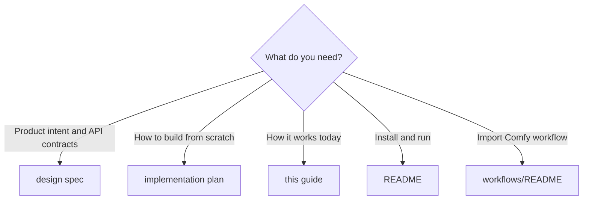

---

*Last updated to reflect ComfyUI workflow mode, port 4000 via `.env.local`, exFAT-safe output scanning, ComfyUI error 810/801 handling, NSFW defaults, and `localStorage` preferences.*
