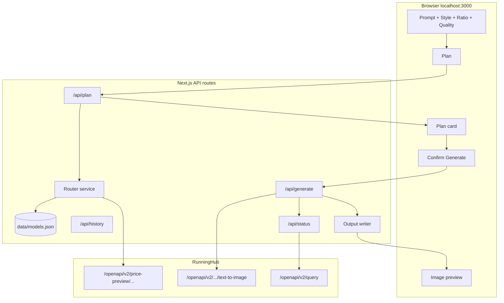

# RunningHub NSFW Image Generator — Design Spec

**Date:** 2026-05-21  
**Project:** `runninghub-app` (local, personal use)  
**Status:** Approved in brainstorming

## Summary

A local Next.js app that generates NSFW images via RunningHub APIs. The user enters a prompt and optional controls (style, aspect ratio, quality tier); a **curated router** proposes the best cost/performance model route with an estimated price; the user **confirms** before spend; results are saved under `./outputs/` for learning and reuse.

Inspired by [nsfwaiartgenerator.io](https://nsfwaiartgenerator.io/) UX density, but powered by [RunningHub 全能图片G-2-文生图](https://www.runninghub.cn/call-api/api-detail/2046514150500524034) and related standard model APIs. Patterns borrowed from `face-swap-poc` (server-side API proxy, polling) without auth, payments, or Supabase.

## Goals

- Single-user, no authentication
- Prompt in → plan (model + params + price + reason) → confirm → image out
- Transparent routing so the operator learns RunningHub model tradeoffs over time
- Persistent local history on disk (`./outputs/`)
- Best cost/performance among a **curated allowlist**, not the full RunningHub catalog

## Non-goals (v1)

- Negative prompt field
- Image-to-image, video, or ComfyUI workflow execution
- Telegram / Hermes agent integration
- Cloud deployment (Vercel) or remote storage
- Public multi-user access
- Automatic retries on failure

## Constraints

- **Runtime:** Local Mac only (`npm run dev`)
- **Secrets:** `RH_API_KEY` in `.env.local` (server-side only)
- **RunningHub:** Requires paid membership for API; async task model (submit → poll `/openapi/v2/query`)
- **NSFW:** Some routes may block adult content; catalog entries must be marked `nsfwOk` based on empirical testing

## Architecture



### Directory layout

```
runninghub-app/
├── .env.local                 # RH_API_KEY
├── .gitignore                 # outputs/, .plans/, .env.local
├── data/
│   └── models.json            # curated routes + style affinity
├── outputs/                   # gitignored; per-run artifacts
├── .plans/                    # gitignored; short-lived plan snapshots
├── docs/superpowers/specs/
│   └── 2026-05-21-runninghub-nsfw-generator-design.md
└── src/
    ├── app/
    │   ├── page.tsx
    │   └── api/
    │       ├── plan/route.ts
    │       ├── generate/route.ts
    │       ├── status/route.ts
    │       ├── history/route.ts
    │       └── reveal/route.ts
    └── lib/
        ├── runninghub.ts
        ├── router.ts
        ├── output-store.ts
        └── plans.ts
```

## UI (single page)

### Controls (defaults)

| Control | Default | Notes |
|---------|---------|-------|
| Prompt | empty | 1–20000 chars (RunningHub limit) |
| Style | Realistic | Chips: Anime, Realistic, Hentai, Hassaku |
| Aspect ratio | `1:1` | Includes 16:9, 9:16, etc. per API enum |
| Quality tier | Medium | Maps to resolution + quality per model |

### Actions

1. **Plan** — calls `/api/plan`; shows model, params, estimated ¥, reason, up to 2 alternatives
2. **Confirm** — calls `/api/generate` with `planId`; polls status
3. **Edit plan** — return to controls and re-plan
4. **History** — dropdown from `/api/history`; reload past run
5. **Download / Open folder** — after success (folder via `/api/reveal` on macOS)

### Layout

Two-column: left = inputs; right = plan card → progress → image preview.

## API contracts

### `POST /api/plan`

**Request:**

```json
{
  "prompt": "string",
  "style": "anime | realistic | hentai | hassaku",
  "aspectRatio": "1:1",
  "qualityTier": "low | medium | high"
}
```

**Response:**

```json
{
  "planId": "uuid",
  "route": "rhart-image-g-2-official/text-to-image",
  "modelLabel": "全能图片G-2-文生图-官方稳定版",
  "params": {
    "prompt": "enhanced prompt",
    "aspectRatio": "1:1",
    "resolution": "2k",
    "quality": "medium"
  },
  "estimatedPrice": 0.76,
  "currency": "CNY",
  "reason": "string",
  "alternatives": []
}
```

Plan snapshot stored at `.plans/<planId>.json` (TTL 5 minutes).

### `POST /api/generate`

**Request:** `{ "planId": "uuid" }`

**Response:** `{ "jobId": "uuid", "taskId": "string", "status": "RUNNING" }`

### `GET /api/status?jobId=...`

Poll every 8s, max 60 attempts (6 minutes).

- `RUNNING` — include optional `progress` estimate
- `SUCCESS` — `imageUrl`, `outputPath`, `usage`
- `FAILED` — `errorMessage`

### `GET /api/history`

Last 50 runs from `./outputs/**/metadata.json`, newest first.

### `GET /api/reveal?jobId=...`

Local-only: runs `open <outputDir>` on macOS after path validation.

## Router

### Catalog entry schema (`data/models.json`)

```json
{
  "id": "g2-official",
  "label": "全能图片G-2-文生图-官方稳定版",
  "route": "rhart-image-g-2-official/text-to-image",
  "nsfwOk": true,
  "styles": ["realistic", "hentai", "hassaku"],
  "tierMap": {
    "low": { "resolution": "1k", "quality": "low" },
    "medium": { "resolution": "2k", "quality": "medium" },
    "high": { "resolution": "4k", "quality": "high" }
  },
  "priority": 10
}
```

### Algorithm

1. Filter `nsfwOk === true`
2. Filter by style affinity
3. Map `qualityTier` → `resolution` + `quality`
4. Append style suffix to prompt (store both original and enhanced)
5. Price-preview each candidate (max 4) via `/openapi/v2/price-preview/{route}`
6. Rank by tier rules:
   - **high** — priority first, then price among top 2
   - **medium** — balance priority and price
   - **low** — lowest `estimatedPrice`
7. Return winner + alternatives + human-readable `reason`

### Style suffixes (v1)

| Style | Suffix |
|-------|--------|
| Anime | `, anime style, vibrant colors, detailed illustration` |
| Realistic | `, photorealistic, natural lighting, high detail` |
| Hentai | `, anime art style, mature themes` |
| Hassaku | `, soft anime shading, clean lineart` |

### Starter allowlist

| id | Use when |
|----|----------|
| `g2-official` | Realistic / Hassaku / high tier |
| `g2-budget` | Low tier / draft |
| Style-specific route | Anime / Hentai if validated NSFW-ok; else G-2 + suffix |

## RunningHub integration

- **Base URL:** `https://www.runninghub.cn`
- **Auth:** `Authorization: Bearer ${RH_API_KEY}`
- **Submit:** `POST /openapi/v2/{route}` with plan params
- **Poll:** `POST /openapi/v2/query` with `taskId`
- **Price:** `POST /openapi/v2/price-preview/{route}` with same body as submit

Reference endpoint (primary): `rhart-image-g-2-official/text-to-image` — fields: `prompt`, `aspectRatio`, `resolution`, `quality`.

## Output storage

```
outputs/2026-05-21/<jobId>/
├── metadata.json
├── plan.json
└── image.png
```

**metadata.json** includes: jobId, taskId, timestamps, prompts, style controls, route, modelLabel, estimated and actual usage, status, imageFile path.

## Error handling

| Case | Response / UX |
|------|----------------|
| Missing `RH_API_KEY` | 500 at startup / first API call with config hint |
| All price-previews fail | 502 — check membership / key |
| Submit/poll failure | FAILED status; metadata saved without image |
| Poll timeout (6 min) | FAILED with timeout message |
| Model NSFW block | Show error; user can edit style/tier and re-plan |

No automatic retry in v1.

## Tech stack

- Next.js 15 App Router, TypeScript
- Tailwind CSS (dark UI)
- Native `fetch` for RunningHub
- No database, no auth

## Future (out of scope)

- Telegram bot client → same `/api/generate`
- LLM-based router upgrade
- ComfyUI workflow support
- Negative prompt
- Cloud deploy + object storage

## Decisions log

| Decision | Choice |
|----------|--------|
| Project location | `runninghub-app`, greenfield |
| Auth | None |
| UI scope | Generator only |
| Routing UX | Plan then confirm |
| Controls | Prompt + style + ratio + quality (defaults) |
| History | `./outputs/` on disk |
| Runtime | Local Mac only |
| Negative prompt | Not in v1 |
| Primary approach | UI + curated router (not Hermes) |
